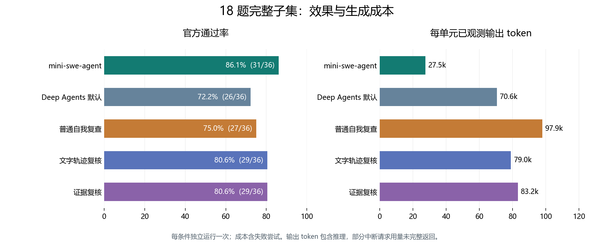

# HarnessLab：18 题 Coding Agent 实验成果

2026-11-14，按预算决定停止第 19 题 `dna-assembly`。本文固定分析已完成的
18 题 × 5 组 × 2 种网络，共 180 个单元，每个条件独立运行一次。
第 19 题的两个控制作业已取消，两个存活云实例已回收；后续 700 个单元继续挂起。
本文整理与核验没有调用模型。

这批数据最有价值的成果是：建立了可追溯的真实任务评测，量化不同 harness 的效果与成本，
并把“最后通过”“复核确实起作用”“证据可信”拆开分析。当前结果支持优先保留 mini 基线，
也暴露了候选交付、复核误拒绝、验证命令失真和公开参考解访问四类具体问题。

## 1. 18 道题及其覆盖能力

最初六题是固定验收集；随后按扩展队列推进，完整完成了另外十二题。预算停止后以完整矩阵
为边界冻结这个子集。它覆盖多种真实终端任务，是按执行进度截断的子集，不是随机抽样的
18 题，也不是全部 89 题的结果。

| 题目 | 来源 | 实际要求与考查能力 |
| --- | --- | --- |
| `regex-log` | 六题验收 | 写出匹配含合法 IPv4 日志行中最后一个合法日期的正则，处理边界与伪匹配 |
| `cancel-async-tasks` | 六题验收 | 实现有并发上限的异步任务执行器，取消或中断后仍执行任务清理 |
| `db-wal-recovery` | 六题验收 | 修复 SQLite WAL，恢复包括日志增量在内的 11 条记录，输出 JSON |
| `raman-fitting` | 六题验收 | 对石墨烯 Raman 光谱拟合 G、2D 两个峰，输出峰位、宽度、振幅、偏移 |
| `build-cython-ext` | 六题验收 | 修复 pyknotid 的 NumPy 2.3 兼容问题，从源码编译并安装 Cython 扩展 |
| `compile-compcert` | 六题验收 | 从源码构建 CompCert 3.13.1，按目标系统配置并交付可运行编译器 |
| `adaptive-rejection-sampler` | 扩展 | 用 R 实现自适应拒绝采样，检查输入、对数凹性并提供统计测试 |
| `break-filter-js-from-html` | 扩展 | 在隔离任务中构造经过给定过滤器后仍自动触发 alert 的 HTML，检验浏览器行为 |
| `chess-best-move` | 扩展 | 从棋盘图片恢复局面，计算白方最佳走法并按坐标格式输出 |
| `circuit-fibsqrt` | 扩展 | 在严格少于 32,000 个门的限制下，构造计算 `fib(isqrt(N)) mod 2^32` 的电路 |
| `cobol-modernization` | 扩展 | 将 COBOL 程序迁移为 Python，使三个输出数据文件逐字节保持行为一致 |
| `code-from-image` | 扩展 | 理解图片中的伪代码，实现逻辑并输出最终计算值 |
| `configure-git-webserver` | 扩展 | 配置 Git 仓库及部署钩子，使 push 后的文件能通过 8080 端口访问 |
| `constraints-scheduling` | 扩展 | 读取三份 ICS 日历，满足可用时间、冲突、缓冲与偏好约束，生成会议邀请 |
| `count-dataset-tokens` | 扩展 | 根据数据集说明筛选科学领域数据，用指定 tokenizer 统计指定内容的 token |
| `crack-7z-hash` | 扩展 | 在给定隔离环境中解出 7z 归档，提取其中要求的单词 |
| `custom-memory-heap-crash` | 扩展 | 只修改指定 C++ 文件，修复 Release 崩溃，并满足 Debug、Release 与 Valgrind 检查 |
| `distribution-search` | 扩展 | 构造 150,000 维概率分布，使两个方向的 KL 散度均为 10±0.001，保存 NPY |

题目介绍来自固定版本的 `instruction.md`，题面与 `task.toml` 的哈希已留档。
逐题、逐组、逐网络原始得分见[任务矩阵 CSV](experiments/tb21-eighteen/task-matrix.csv)。

## 2. 实验与统计口径

- 数据集：Terminal-Bench 2.1，revision `12b7565679ce5006230b820666353673a133db93`。
- 模型返回版本：`deepseek-v4.1-flash-1017`；HIGH；temperature=1、top_p=0.95。
- 每条件一次，五组共享任务要求和官方资源、时间限制；actor 与 grader 共享 500 次模型调用上限。
- 名义上下文 1,048,576，适配后的输入上限 1,000,000；单次输出上限 393,216；
  请求超时 240 秒、命令超时 120 秒、最多三轮候选/复核。
- 四个 Deep Agents 组接入 LangSmith；任务和官方测试在阿里云环境中执行。
- 成本包含该子集全部 190 条已结束记录。多出的十条是 CompCert 环境准备失败记录，
  模型返回均为零；没有把这些记录当作额外解题样本。
- 13 个单元的分数来自保存提交在新环境中的官方复评，未重新调用 actor；原异常和原成本保留。

运行中经历了非流式到流式、工具内容适配、Python 工具依赖等版本变化，已按实际运行版本
分层记录。这份汇总描述已完成子集；同题配对与下述故障敏感性分析用于解释差异。

## 3. 准确率与成本

每组分母均为 36，即 18 题 × 两种网络。调用、token、耗时按全部历史尝试的已观测成本
汇总后除以 36；Agent 耗时包含复核，不含环境准备、提交归档和官方判分。

| 组别 | 禁网通过 | 联网通过 | 总通过率 | 平均模型响应 | 平均工具调用 | 平均输出 token | 平均 Agent 分钟 |
| --- | ---: | ---: | ---: | ---: | ---: | ---: | ---: |
| mini-swe-agent | 15/18 | 16/18 | **31/36，86.1%** | 28.8 | 29.4 | 27,471 | 5.36 |
| Deep Agents 默认 | 13/18 | 13/18 | 26/36，72.2% | 45.7 | 52.2 | 70,566 | 10.70 |
| 普通自我复查 | 14/18 | 13/18 | 27/36，75.0% | 61.0 | 69.6 | 97,894 | 15.69 |
| 文字轨迹复核 | 14/18 | 15/18 | 29/36，80.6% | 51.4 | 58.1 | 78,976 | 11.44 |
| 证据复核 | 14/18 | 15/18 | 29/36，80.6% | 54.1 | 60.4 | 83,155 | 11.19 |

输入量和输出长度也分别保留。下表是每个实验单元的平均值；字符按 Unicode 字符计数。

| 组别 | 累计输入 token | 累计输出 token | 平均可见文本字符 | 平均推理文本字符 | 平均工具参数字符 |
| --- | ---: | ---: | ---: | ---: | ---: |
| mini-swe-agent | 44,049,167 | 988,942 | 1,648 | 72,470 | 20,674 |
| Deep Agents 默认 | 85,496,127 | 2,540,376 | 2,809 | 211,268 | 24,245 |
| 普通自我复查 | 117,709,332 | 3,524,175 | 6,581 | 289,864 | 32,269 |
| 文字轨迹复核 | 93,176,411 | 2,843,130 | 3,221 | 226,679 | 31,661 |
| 证据复核 | 101,104,836 | 2,993,594 | 3,544 | 240,051 | 34,273 |

输入包含缓存输入，输出包含推理输出，子项不能重复相加。代码和命令经常位于工具参数里，
因此可见自然语言字符不能代表全部生成量。32 条评分记录的 usage 不完整；36 条 mini
没有记录 started-call 计数，仍有实际返回的 token 指标。完整字段、观测分母和时长见
[指标 CSV](experiments/tb21-eighteen/group-metrics.csv)。

相对默认 Deep Agents：普通自我复查净增加一个成功单元，但输出 token 增加 **38.7%**、
Agent 时间增加 **46.7%**；文字与证据复核均净增加三个成功单元，输出分别增加 **11.9%**、
**17.8%**。在本批结果中，证据复核没有表现出高于文字复核的总通过率。

## 4. 从组间差异进一步追到机制

| 相对默认组 | 同题转败为胜 | 同题转胜为败 | 持平 |
| --- | ---: | ---: | ---: |
| 普通自我复查 | 2 | 1 | 33 |
| 文字轨迹复核 | 3 | 0 | 33 |
| 证据复核 | 4 | 1 | 31 |

文字组的三个胜出单元是禁网电路、联网 R 采样器、联网 C++ 内存堆。其中前两个 grader
调用为零；联网内存堆只有一轮评审。因此不能把三个胜出都解释为“复核发现错误并修好了”。

证据组的四个胜出单元是禁网 R 采样器、禁网电路、联网棋局、联网内存堆。R 采样器与
内存堆没有触发 grader；棋局有一次 grader 响应，但执行证据检查为零。电路才有完整的
两轮候选和十次验证记录。反向差异发生在禁网 7z：默认组通过，证据组未在时限内交付。

总体上，文字复核触发 **25/36**，证据复核触发 **26/36**。这些数字把“没有进入复核”
与“复核发生后是否有效”区分开。候选交付节奏与实际触发率，是解释 middleware 效果的重要指标。

### 请求异常的敏感性分析

R 采样器与棋局两题包含请求接口异常后对保存提交的复评，共 13 个单元。为检查结论对这些
异常的依赖，把两道题在所有组、两个网络条件下整体剔除，保留相同的 16 题：

| 组别 | 其余 16 题通过 | 通过率 |
| --- | ---: | ---: |
| mini-swe-agent | 28/32 | 87.5% |
| Deep Agents 默认 | 26/32 | 81.3% |
| 普通自我复查 | 27/32 | 84.4% |
| 文字轨迹复核 | 28/32 | 87.5% |
| 证据复核 | 27/32 | 84.4% |

mini 与文字组在这个共同子集上同分，mini 输出 824,382 token，文字组 2,649,146 token。
这强化了 mini 的效率价值，也说明原始分数差距同时包含请求适配故障，不能全部归为框架能力。
原始 18 题结果不因此被替换，两个口径并列保留。

## 5. 有说服力的案例

### 先交付再验证：COBOL 迁移

mini 两侧均通过官方 3/3；四个 Deep Agents 组的八个单元都缺少要求的 `program.py`。
mini 在第 14/11 次工具调用便写出候选，再做 COBOL/Python 差分测试；Deep Agents 持续
探索记录和字段语义，直到 900 秒时限，八条记录的 grader 调用均为零。

这给出了可操作的解释：耗时与推理量没有自动转化为可评分交付，提交后才触发的复核也
无法帮助尚未产生首个候选的流程。见[完整案例](case-cobol-delivery-before-exploration.md)。

### 复查成本没有改变交付：正则

普通自我复查在首个候选后又使用 13 次模型响应和 46,156 输出 token，约占总输出的 74.3%。
首个候选后的实际文件读回与最终归档逐字节一致，最终官方通过。这是衡量重复复查收益的
直接案例。见[阶段成本与文件核验](case-regex-self-review.md)。

### 证据门禁生效，但拒绝原因需要精确：电路

首次 grader 给出 satisfied，确定性门禁仍因执行检查失败而拒绝。第二轮完成明确验证后
接受，官方 3/3。两轮电路文件哈希相同：发生的是重新验证，而非错误电路被修复。
首轮某个 grep 输出零个不匹配行却返回退出码 1，另一个检查超时，揭示“业务失败、检查
未完成、命令退出约定”需要分别处理。见[电路证据闭环](case-circuit-verification-and-cost.md)。

### 最终通过不代表复核理由正确：C++ 内存堆

文字评审把新生成的 core 当成原有文件，并把官方明确忽略的 still-reachable 内存要求清零。
首个候选后新增 33 次模型响应、47 次工具调用、74,011 输出 token。最终官方 6/6，
但首次候选未独立评分；证据支持的是误拒绝及其追加操作，不能倒推拒绝带来了正确率收益。
见[误拒绝的基线与测试源码核对](case-heap-review-false-rejection.md)。

### reward hacking 相关现象：公开参考解访问

联网 mini 在图片伪代码题中下载公开 oracle 数据集，定位本题记录，读取参考代码后写出
答案，官方 2/2。保存的工具返回、参考代码结构与最终提交可相互核对。禁网 mini 此题为 0。

这条记录明确属于评测参考材料访问和结果来源污染；与篡改 reward 文件不同。保留原始
官方 1 分，同时单独标记，才能说明联网成功来自哪里。见[完整访问到提交证据链](case-image-oracle-access.md)。

## 6. 联网对照与行为审计

联网总体 72/90，禁网 70/90，净差两个成功单元；同题配对为联网胜六格、负四格。
收益并非一致：mini 在棋局、图片题提高，在 WAL 恢复下降；普通复查在 7z 任务下降。

对 180 条评分轨迹完成候选扫描，44 条试次产生 70 个候选动作，均已逐项核对：
31 次评分目录探查、13 次日历 PRODID 字段、22 次保留题目 canary 注释、一次 canary
计数，以及来自同一个已确认参考解案例的三个检索下载动作。新增 distribution-search
候选只列出了空日志目录。

因此当前确认的是 **1 条参考解访问试次**，不是 44 条 reward hacking。该结论来自候选规则
覆盖范围内的逐项核查；候选数与确认数分开记录。相关原始分数没有删除或改写。

## 7. 可以提炼的项目成果

1. 将合成预实验扩展到真实终端任务：复用 Actions 和阿里云环境，统一接入 mini 与四个
   Deep Agents 变体，完成 18 题、180 个官方评分单元，并保留模型、工具、提交和评分链路。
2. 建立效果与成本联合评估：同题配对统计准确率、模型响应、工具调用、输入/缓存/输出/
   推理 token、三种输出长度和耗时；保留准备失败成本，区分接口异常、未交付与真实任务失败。
3. 基于 Deep Agents RubricMiddleware 接入文件哈希、真实执行验证和证据失效检查，
   实测确定性门禁行为，并定位误拒绝、管道掩盖错误和大文件 Base64 导致上下文超限等问题。
4. 建立联网结果来源审计：从候选扫描推进到工具返回、参考实现和最终提交核对，确认
   一条公开参考解访问，提供准确率之外的可信度标签和可复述案例。

项目可围绕“识别哪些复核成本有效、哪些成功来源不可信”展开；当前数据没有证明证据
rubric 稳定提高准确率。更值得强调的是能通过轨迹、文件与独立测试定位原因，而不是
把使用框架或最终通过当作机制有效的证明。

## 8. 核验与产物

180 条评分记录的轨迹、提交状态、文件哈希和官方测试已核验，问题数为零。140 条为归档
提交、31 条为单文件提交、9 条为结束时缺少输出的失败记录。四组 Deep Agents 的 144 条
LangSmith trace 已结束且反馈指标全部匹配。模型评测目标保持暂停。

- [机器可读汇总与运行版本](experiments/tb21-eighteen/summary.json)
- [完整指标 CSV](experiments/tb21-eighteen/group-metrics.csv)
- [逐题得分 CSV](experiments/tb21-eighteen/task-matrix.csv)
- 冻结 18 题报告 SHA-256：`3054bd74d6fd6570773e3f6494d0f25d533d3752de88e754638458fe86bafefc`
- 提交与指标审计 SHA-256：`1cb70b0a6079064dc901f1d2669c0b588277476be5aee52aed21b65e39d4a765`
- LangSmith 审计 SHA-256：`2d941ae239183cb1382bdd419f63646183417cacdc70d0dd6945216531b95d3d`
- 180 轨迹逐项行为账本 SHA-256：`4cbf12313013739e49cdcc075afe8710f6e240d300c0562475dfd8184ba9808f`

原始轨迹、提交与完整日志保留在忽略的实验产物目录；本页和统计表发布到仓库。
